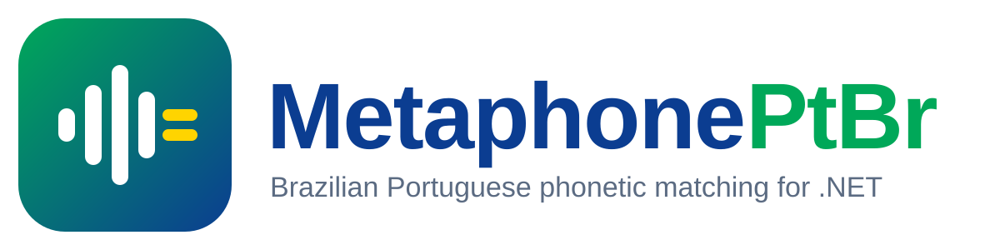

<p align="center"></p>

<p align="center"><strong>Brazilian Portuguese phonetic matching for .NET</strong></p>

<p align="center">
  <a href="https://www.nuget.org/packages/MetaphonePtBr"></a>
  <a href="https://www.nuget.org/packages/MetaphonePtBr"></a>
  <a href="https://github.com/crisbraatz/metaphone-pt-br/actions/workflows/ci.yml"></a>
  
  
  <a href="https://github.com/crisbraatz/metaphone-pt-br/blob/main/LICENSE"></a>
</p>

---

## ✨ What it is

MetaphonePtBr turns a single Brazilian Portuguese word into a stable phonetic token. Words that sound alike share the same token, so names, addresses and brands can be matched even when they are spelled differently or contain typos. For example, `Christopher`, `Cristofer` and `Cristophr` all produce `KRSTF`.

- **Name search:** a user finds a customer even when the spelling differs.
- **Address search:** street and neighbourhood names.
- **Product and brand matching:** typo-tolerant lookup.
- **Duplicate detection:** records whose words sound alike.
- **Targets:** `netstandard2.0` (including .NET Framework 4.6.1 and later) and `net10.0`.
- **Trimmable and AOT compatible** on `net10.0`.

## 🚀 Quick start

```bash
dotnet add package MetaphonePtBr
```

Add `using MetaphonePtBr;`, then call `Metaphone.Encode` to get the token. It throws when the input is invalid:

```csharp
using MetaphonePtBr;

string token = Metaphone.Encode("Cristopher"); // "KRSTF"
```

If you prefer not to handle exceptions, call `Metaphone.TryEncode`. It returns `false` for invalid input and never throws:

```csharp
using MetaphonePtBr;

if (Metaphone.TryEncode(userInput, out string? token))
{
    // token is the phonetic token for a valid word
}
```

## 🔁 How it works

```text
 "Cristopher" ──▶ 🧹 normalize ──▶ 🔤 fold accents ──▶ 📏 rules ──▶ "KRSTF"
                  validate,         Á→A, Ü→U,           left to right,
                  ignore case       Ç kept              by priority
```

| Stage | What happens |
|-------|--------------|
| Normalize | The word is validated and its case is ignored. |
| Fold accents | Accented letters are folded to their base letters, so the result uses only `A` to `Z` plus `Ç`. |
| Rules | The word is read from left to right. For each letter, the engine checks the rules in priority order. A rule can look at the current letter, the letters before and after it, and the letters around them. A letter that matches no special rule keeps its default sound. |
| Token | The matched results are joined into the phonetic token. |

The full rule set is in the [rule reference](#-rule-reference) below. The design is described in [docs/architecture.md](https://github.com/crisbraatz/metaphone-pt-br/blob/main/docs/architecture.md).

## 🎯 Matching example

These spelling variations produce the same token:

| Spelling | Token |
|----------|-------|
| Christofer | `KRSTF` |
| Christofr | `KRSTF` |
| Christopher | `KRSTF` |
| Christophr | `KRSTF` |
| Cristofer | `KRSTF` |
| Cristofr | `KRSTF` |
| Cristophr | `KRSTF` |

Compare tokens to find candidates for a fuzzy match:

```csharp
bool sameSound = Metaphone.Encode("Christopher") == Metaphone.Encode("Cristophr"); // true
```

## 📏 Input contract

| Accepted | Rejected |
|----------|----------|
| A single word | Spaces, hyphens and apostrophes |
| Letters only | Symbols and digits |
| Accented letters `ÁÀÂÃÉÊÍÓÔÕÚÜÇ` and their lowercase forms | Ligatures, ordinal indicators and letters that are not part of Brazilian Portuguese |
| Accents as precomposed characters or combining marks | `null` input |

The result is a phonetic token, not the original word.

## ⚠️ Errors

| Situation | `Metaphone.Encode` | `Metaphone.TryEncode` |
|-----------|--------------------|-----------------------|
| `null` input | Throws `ArgumentNullException` | Returns `false` |
| Input that is not a single supported word | Throws `ArgumentException` | Returns `false` |
| Valid word whose letters are all bypassed (for example `H`, `RR` or `LH`) | Returns an empty token | Returns `true` with an empty token |

`TryEncode` never throws.

## ⚡ Performance

3.0.0 is faster and allocates less than 2.0.14 for every input category measured. Oracle sample words, the closest proxy for real input, run in about 0.61 times the time and 0.38 times the allocations.

| Category | 2.0.14 mean | 3.0.0 mean | Time ratio | Alloc ratio |
|----------|------------:|-----------:|-----------:|------------:|
| Short | 621.1 ns | 354.3 ns | 0.57 | 0.31 |
| Medium | 748.1 ns | 579.0 ns | 0.77 | 0.36 |
| Long | 1,226.2 ns | 969.5 ns | 0.79 | 0.40 |
| Accented | 1,683.9 ns | 661.0 ns | 0.39 | 0.46 |
| OracleSample | 24,726.2 ns | 15,086.8 ns | 0.61 | 0.38 |

Measured with the default BenchmarkDotNet job on an Apple M4. The full tables, the machine details and the instructions to run the benchmarks are in [docs/benchmarks.md](https://github.com/crisbraatz/metaphone-pt-br/blob/main/docs/benchmarks.md).

## 🔄 Migrating from 2.x

Version 3.0.0 replaces the `string` extension method with static methods on `Metaphone`. The phonetic tokens do not change, so existing indexes built with 2.x keep matching.

Before (2.x):

```csharp
using MetaphonePtBr;

string token = "Cristopher".GetMetaphoneToken();
```

After (3.0.0):

```csharp
using MetaphonePtBr;

string token = Metaphone.Encode("Cristopher");
```

If your code relied on the extension method not throwing, use `Metaphone.TryEncode`:

```csharp
using MetaphonePtBr;

if (Metaphone.TryEncode(input, out string? token))
{
    // use token
}
```

| 2.x | 3.0.0 |
|-----|-------|
| `"word".GetMetaphoneToken()` | `Metaphone.Encode("word")` |
| `"word".GetMetaphoneToken()` without exceptions | `Metaphone.TryEncode("word", out var token)` |

## 📚 Rule reference

Each table lists a pattern and the token it produces. The symbols used in the patterns are explained first. The rules match the 2.0.14 behavior. Expand a letter to see its rules.

### Symbols

| Symbol | Meaning                             |
|:------:|:------------------------------------|
| Letter | Letter                              |
|  `^`   | Beginning of word                   |
|  `$`   | End of word                         |
|  `[]`  | One occurrence of any listed letter |
|  `v`   | Any vowel                           |
|  `c`   | Any consonant                       |
|  `.`   | Any letter                          |
|  `0`   | Bypass                              |

<details><summary><strong>C</strong></summary>


| Rule  | Result |
|:-----:|:-------|
|  CHR  | K      |
|  CH   | X      |
| C[EI] | S      |
| C[QK] | 0      |
|   C   | K      |
|  C$   | K      |
|   Ç   | S      |


</details>

<details><summary><strong>G</strong></summary>


| Rule  | Result |
|:-----:|:-------|
| GH[v] | J      |
| GH[c] | GJ     |
| G[EI] | J      |
|   G   | G      |


</details>

<details><summary><strong>H</strong></summary>


| Rule  | Result |
|:-----:|:-------|
| ^H[v] | v      |
|   H   | 0      |


</details>

<details><summary><strong>Immutables</strong></summary>


| Rule | Result |
|:----:|:-------|
|  B   | B      |
|  D   | D      |
|  F   | F      |
|  J   | J      |
|  K   | K      |
|  M   | M      |
|  V   | V      |


</details>

<details><summary><strong>L</strong></summary>


| Rule | Result |
|:----:|:-------|
|  LH  | 0      |
|  ^L  | L      |
| L[v] | L      |
|  L   | 0      |


</details>

<details><summary><strong>N</strong></summary>


| Rule | Result |
|:----:|:-------|
|  N$  | M      |
|  NH  | 0      |
|  NN  | 0      |
|  N   | N      |


</details>

<details><summary><strong>P</strong></summary>


| Rule | Result |
|:----:|:-------|
|  PH  | F      |
|  P   | P      |


</details>

<details><summary><strong>Q</strong></summary>


| Rule | Result |
|:----:|:-------|
|  Q   | K      |


</details>

<details><summary><strong>R</strong></summary>


| Rule | Result |
|:----:|:-------|
|  ^R  | 0      |
|  R$  | 0      |
|  RR  | 0      |
| vRv  | R      |
| .Rc  | R      |
| cRv  | R      |


</details>

<details><summary><strong>S</strong></summary>


|  Rule   | Result |
|:-------:|:-------|
|   SS    | S      |
|   SH    | X      |
|   vSv   | Z      |
| SC[EI]  | S      |
| SC[AOU] | SK     |
|   SCH   | X      |
|  SC[.]  | S      |
|    S    | S      |


</details>

<details><summary><strong>T</strong></summary>


| Rule | Result |
|:----:|:-------|
|  TH  | T      |
|  T   | T      |


</details>

<details><summary><strong>Vowels</strong></summary>


| Rule | Result |
|:----:|:-------|
| ^[v] | v      |


</details>

<details><summary><strong>W</strong></summary>


| Rule  | Result |
|:-----:|:-------|
| W[v]  | V      |
| W[LR] | V      |
| W[c]  | 0      |
|  W$   | 0      |


</details>

<details><summary><strong>X</strong></summary>


|        Rule         | Result |
|:-------------------:|:-------|
|         X$          | X      |
|       ^EX[v]        | Z      |
|       .EX[EI]       | X      |
|      .EX[AOU]       | KS     |
|        EX[C]        | S      |
|       EX[PT]        | S      |
|        EX[.]        | KS     |
|  [vCKGLRX][AIOU]X   | X      |
| [DFMNPQSTVZ][AIOU]X | KS     |
|          X          | X      |


</details>

<details><summary><strong>Y</strong></summary>


| Rule | Result |
|:----:|:-------|
|  Y   | I      |


</details>

<details><summary><strong>Z</strong></summary>


| Rule | Result |
|:----:|:-------|
|  Z$  | S      |
|  Z   | Z      |

</details>

## 🛠️ Development

Requires the .NET SDK pinned in [`global.json`](https://github.com/crisbraatz/metaphone-pt-br/blob/main/global.json).

| Command | Purpose |
|---------|---------|
| `dotnet tool restore` | Restore local tools |
| `dotnet build -c Release` | Build |
| `dotnet test` | Run the tests |
| `dotnet format --verify-no-changes` | Check formatting |
| `dotnet stryker --config-file tests/MetaphonePtBr.Tests/stryker-config.json --solution MetaphonePtBr.slnx` | Mutation testing, break threshold 90% |
| `dotnet run -c Release --project benchmarks/MetaphonePtBr.Benchmarks` | Run the benchmarks |
| `dotnet pack src/MetaphonePtBr -c Release -o artifacts` | Build the NuGet package |

## 📦 Releasing

Push a `vX.Y.Z` tag that matches `<Version>` in `Directory.Build.props`. The [release workflow](https://github.com/crisbraatz/metaphone-pt-br/blob/main/.github/workflows/release.yml) publishes to NuGet.org with Trusted Publishing and creates a GitHub Release. A dry run is available from the Actions tab (`workflow_dispatch`); it builds, tests and packs without publishing. The full guide is in [docs/releasing.md](https://github.com/crisbraatz/metaphone-pt-br/blob/main/docs/releasing.md).

## 🤝 Contributing

See [CONTRIBUTING.md](https://github.com/crisbraatz/metaphone-pt-br/blob/main/CONTRIBUTING.md), the [Code of Conduct](https://github.com/crisbraatz/metaphone-pt-br/blob/main/CODE_OF_CONDUCT.md) and the [Security Policy](https://github.com/crisbraatz/metaphone-pt-br/blob/main/SECURITY.md). Changes are listed in the [CHANGELOG](https://github.com/crisbraatz/metaphone-pt-br/blob/main/CHANGELOG.md).

## 🙏 Credits

Based on [metaphone-ptbr](https://github.com/carlosjordao/metaphone-ptbr) by [Carlos Costa Jordão](https://github.com/carlosjordao).

## 📄 License

[MIT](https://github.com/crisbraatz/metaphone-pt-br/blob/main/LICENSE)
